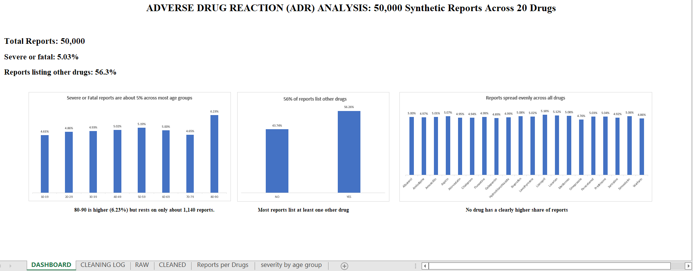

# ADR Analysis Dashboard (Excel)

**Practice project on 50,000 synthetic adverse drug reaction reports across 20 drugs. The data is synthetic, so findings do not apply to real drugs.**

## Questions
- Which drugs get the most reports?
- How does severity change with age?
- How common are concomitant drugs?

## Cleaning log
| Step | What I did | Why |
|---|---|---|
| 1 | Kept an untouched copy of the raw data (RAW sheet) | Original data preserved |
| 2 | Converted the data to an Excel Table | Formulas and pivots update automatically |
| 3 | Removed "mg" from Dosage and converted to numbers | So doses can be calculated with |
| 4 | Added a yes/no concomitant-drug column from the ConcomitantDrugs column | Blank means no other drugs listed |
| 5 | Checked ReportID for duplicates | None found |
| 6 | Checked Seriousness categories | Four values: fatal, mild, moderate, severe |
| 7 | Grouped Seriousness into Severe/fatal versus Not severe | A single outcome to compare across groups |
| 8 | Grouped age into 10-year bands | Readable comparison |
| 9 | Built PivotTables using % of row total | Compare rates, not raw counts, across groups of different sizes |
| 10 | Set all chart axes to start at 0 | Avoids exaggerating small differences |

## Findings
- Reports are spread evenly across the 20 drugs (2,382 to 2,591 each).
- 5.03% of reports are severe or fatal.
- The severe or fatal share is about 4.6% to 5.2% in most age bands. The 80-90 band is 6.23%, but it rests on only about 1,140 reports.
- 56% of reports list other drugs.

## Limits
- Synthetic data, so findings do not apply to real drugs.
- A report does not prove a drug caused a reaction.
- ADR codes are not decoded.
- No statistical tests were run.

## Files
- `first project.xlsx`: full workbook (RAW, CLEANED, pivots, dashboard)
- `dashboard.png`: dashboard screenshot

## Source and tools
Dataset: https://www.kaggle.com/datasets/amritanshukush/adverse-drug-reaction-adr-reporting. Built in Excel (PivotTables, slicers, calculated columns, charts).
